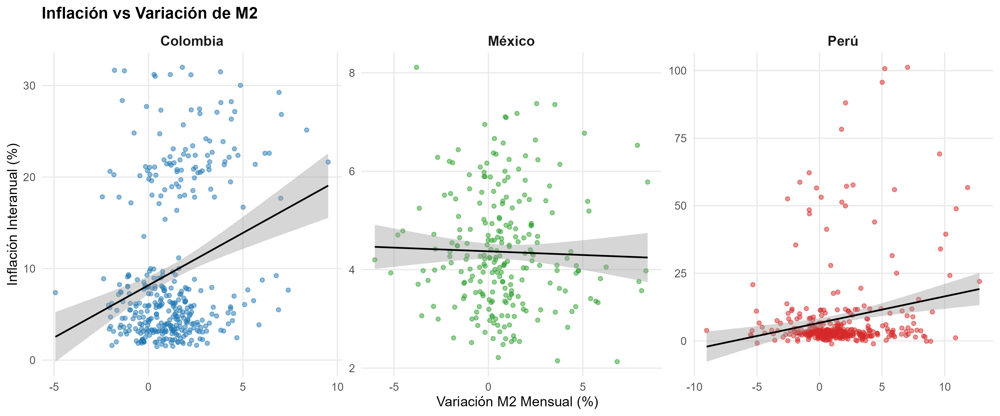

# Inflation and Labor Income — Stata & R

Two-part empirical report for the M.Sc. in Applied Economics (Universidad de Buenos Aires):

1. **Inflation dynamics and targets** in Colombia, Mexico and Peru, including the relationship with M2.
2. **Labor income in Argentina** by region and establishment size, using the EPH (3rd quarter 2025).

Estimation and cleaning in Stata; figures in R (`ggplot2`). The report is in Spanish: [`Informe_Dual_Abril_2026.pdf`](Informe_Dual_Abril_2026.pdf).

<p align="center">
  
</p>

## Contenido

```
├── code/
│   ├── inflacion_eph.do      # Stata: limpieza, estadísticas y gráficos (inflación, M2, EPH)
│   └── graficos_r.R          # R: réplica y mejora de los gráficos
├── figuras/                  # gráficos incluidos en el informe
├── data/                     # bases de entrada (no incluidas; ver abajo)
└── Informe_Dual_Abril_2026.pdf
```

## Datos

Los microdatos no se incluyen en el repositorio: descargarlos de las fuentes oficiales y guardarlos en `data/`.

| Archivo en `data/` | Fuente |
|---|---|
| `Datos_Infla.xlsx` | CEPAL — precios al consumidor, América Latina y el Caribe ([CEPALSTAT](https://statistics.cepal.org/portal/cepalstat)) |
| `Datos_M2.xlsx` | Serie de M2 de los tres países |
| `usu_individual_T325.txt` | INDEC — EPH, base usuaria individual, 3.er trimestre 2025 ([INDEC](https://www.indec.gob.ar/indec/web/Institucional-Indec-BasesDeDatos)) |

## Cómo reproducir

Desde la **raíz del repositorio**:

- **Stata** (v14 o superior): `do code/inflacion_eph.do`. El script entra a `data/`, genera las bases intermedias allí y guarda los gráficos en `figuras/`.
- **R**: `Rscript code/graficos_r.R`. Paquetes: `tidyverse`, `readxl`, `scales`, `lubridate`, `ggthemes`, `haven`. Los gráficos se guardan en `figuras_R/`.

## Licencia

Código: [MIT](LICENSE). El informe es del autor, todos los derechos reservados. Los datos pertenecen a sus proveedores y están sujetos a sus términos de uso.
